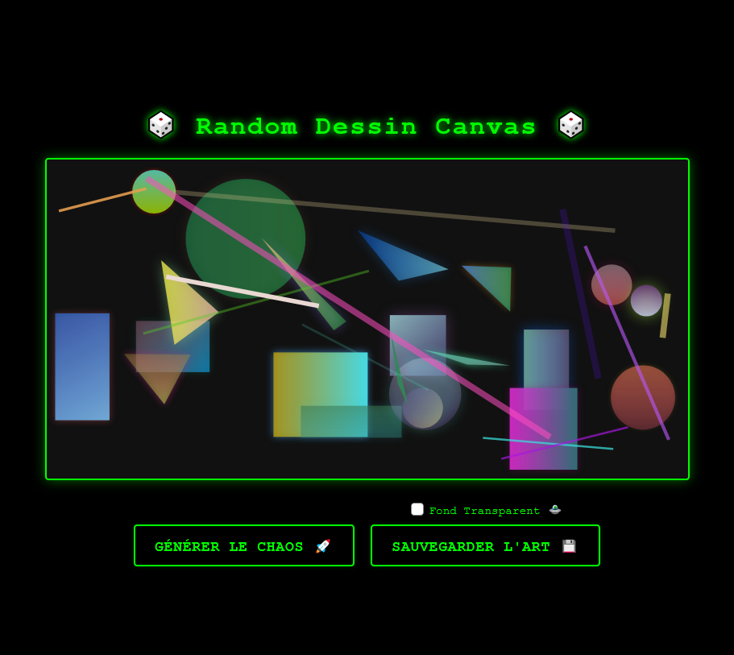

# 🎲 Random Dessin Canvas

Un générateur d'art abstrait géométrique et dynamique basé sur l'API HTML5 Canvas. Cet outil interactif permet de créer instantanément des compositions numériques uniques aux influences cyberpunk/synthwave, combinant des dégradés fluides, des formes proportionnelles et des effets de lueurs néon.

---

⚠️ **Aperçu du projet :**


---

## 🚀 Fonctionnalités

- **Générateur de Chaos Contrôlé :** Création à la volée de formes géométriques (rectangles, cercles, triangles) et de réseaux de lignes interconnectées.
- **Mathématiques Fluides & Adaptatives :** L'algorithme adapte automatiquement la taille et l'épaisseur des formes selon la résolution de l'écran (100 % Responsive Mobile/PC).
- **Rendu Néon Avancé :** Gestion dynamique de l'opacité (RGBA), des gradients linéaires multidirectionnels et des ombres lumineuses (`shadowBlur`).
- **Exportation Intelligente Double-Mode :** Module de téléchargement PNG haute définition capable d'isoler le dessin sur fond transparent (mode sticker/asset) ou de le fusionner sur un fond opaque sombre.
- **Interface Rétro-Terminal :** Design immersif vert fluo inspiré des terminaux de code informatiques.

## 📁 Architecture du Projet

```text
C:.\Random Canvas
|   human.txt
|   index.html
|   README.md
|
+---Assets
|   \---Favicon
|           Favicon.K.sf.blanc.png
|           Favicon.K.sf.png
|
+---Infos
|       structure.txt
|       structure_temp.txt
|
+---JavaScript
|       dessin.js
|       main.js
|
+---Screen_Site
|       Screenshot 2026-10-28 at 09-59-20 Random Dessin Canvas.png
|
\---Style
        style.css
```

## 🛠️ Installation Rapide

1. Clonez le dépôt sur votre machine locale :
   ```bash
   git clone https://github.com/Sylvain-G404/Random-Dessin-Canvas.git
   ```
2. Ouvrez le fichier `index.html` directement dans votre navigateur ou via l'extension _Live Server_ de VS Code.
